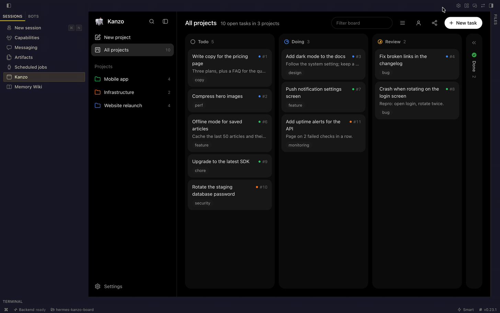
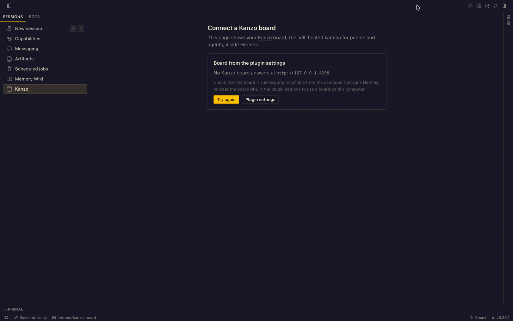

# Kanzo Board for Hermes

[](https://hermes-agent.nousresearch.com/marketplace/kanzo-board)
[](https://github.com/0sahil/hermes-kanzo-board/actions/workflows/ci.yml)
[](https://github.com/0sahil/hermes-kanzo-board/releases/latest)
[](plugin.yaml)
[](LICENSE)

Your [Kanzo](https://github.com/emanuele-em/kanzo) board inside the
[Hermes](https://github.com/NousResearch/hermes-agent) desktop app, one click away in the sidebar,
so you can plan with your agent without switching to a browser tab.

Kanzo is the self-hosted kanban for people and agents by
[Emanuele](https://github.com/emanuele-em): one small program that is both a board in your browser
and an MCP server your agents work through. This plugin brings that board into Hermes:

- **The real board.** The page runs Kanzo's own web UI from your board, so it looks and works
  exactly like Kanzo: drag and drop, the task panel, search and filters, keyboard shortcuts,
  settings. It always matches your Kanzo version.
- **Set up from the page.** No Kanzo yet? The page installs the official release, starts the board,
  or joins a board another computer shares.
- **Your agent on the same board.** One click adds Kanzo's MCP server to Hermes, so the agent can
  list, create, update and comment on tasks while you watch them move.

An unofficial community plugin; not made, reviewed or endorsed by the Kanzo or Hermes projects.



## Requirements

- Hermes Desktop **0.23.1** or newer, on macOS, Linux or Windows.
- Kanzo: already installed, or let the plugin install it (macOS, Linux on x86-64 and ARM, and
  Windows on x86-64; Kanzo publishes builds for these).

## Install

Kanzo Board is listed in the [Hermes plugin catalog](https://hermes-agent.nousresearch.com/marketplace/kanzo-board):

```sh
hermes plugins install kanzo-board --enable
hermes gateway restart
```

Or in Hermes Desktop: **Capabilities → Plugins**, search for **Kanzo Board**, and install.

This installs the commit the catalog reviewed, which can trail this repository's `main`.
`hermes plugins update kanzo-board` moves it to the next reviewed version.

To run the newest code before it reaches the catalog (same plugin, newest `main`, not
catalog-reviewed), install from this repository instead:

```sh
hermes plugins install 0sahil/hermes-kanzo-board --enable
hermes gateway restart
```

Then, in **Capabilities → Plugins**, make sure both switches on the Kanzo Board row are on:
**Agent** (the backend that talks to the board) and **Desktop** (the page). Open **Kanzo** in the
sidebar.

## Setting up the board

The page finds your board by itself. If none answers, it offers what is missing:



1. **Kanzo on this computer.**
   - Not installed: **Install Kanzo** downloads the official release from
     [Kanzo's GitHub releases](https://github.com/emanuele-em/kanzo/releases), checks it against a
     SHA-256 pinned in this plugin ([`dashboard/kanzo_release.json`](dashboard/kanzo_release.json)),
     and puts the `kanzo` program where Kanzo's own installer does (`$CARGO_HOME/bin`, else
     `~/.cargo/bin`). It never replaces a `kanzo` that is already there.
   - Installed but not running: **Start, and keep it running** runs `kanzo service install`, Kanzo's
     own login service (a LaunchAgent on macOS, a systemd user service on Linux, Task Scheduler on
     Windows; undo it with `kanzo service uninstall`). **Start once** runs `kanzo --no-open` until
     you log out.
2. **A board another computer shares.** On that computer, turn on **Share this board** in Kanzo and
   enter the address it shows. This runs `kanzo join <address>`: Kanzo on this computer then shows
   the shared board, and your agents use it too. Kanzo needs to be installed and running here
   first. `kanzo leave` goes back to your own board.
3. **A board somewhere else.** If Hermes runs on a server, or you want a board that this computer's
   Kanzo doesn't manage, set **Board URL** under **Settings → Plugins → Kanzo Board**, for example
   `http://192.168.1.20:4242`. The computer running Hermes must be able to reach it, and that board
   must allow it (Kanzo's `listen` setting).

Kanzo itself stays the same program as anywhere else: you can use it from a browser, the `kanzo`
command and other agents (Claude Code, Codex) at the same time, and it updates itself from its own
sidebar.

## Let the agent use the board

When the board is showing and Hermes has no Kanzo MCP server yet, a bar at the top offers
**Add Kanzo tools**. It runs:

```sh
hermes mcp add kanzo --command <path to kanzo> --args mcp      # board on this computer
hermes mcp add kanzo --url <board URL>/mcp                     # board from the Board URL setting
```

with all of Kanzo's tools enabled. Start a new chat (or run `/reload-mcp`) and ask the agent things
like "what's on my board?" or "add a task to look into the login bug". Kanzo's tools include
`delete_task`; to choose which tools the agent gets, run `hermes mcp configure kanzo`.

If you already added Kanzo's MCP server yourself, the plugin leaves it alone.

## How it works

Kanzo's page refuses to be embedded in other apps (it sends `frame-ancestors 'none'`), so the plugin
can't just show it in a frame. Instead:

1. The backend ([`dashboard/plugin_api.py`](dashboard/plugin_api.py)) fetches the board's own
   `index.html` and `app.js` from your running Kanzo. Nothing of Kanzo is copied into this
   repository.
2. The page shows them in Hermes' sandboxed frame (`SandboxedFrame`: an opaque origin with no access
   to Hermes, its storage or its bridge).
3. A small script ([`dashboard/bridge.js`](dashboard/bridge.js)) runs before Kanzo's and replaces
   what the sandbox takes away: the board's requests go through the plugin's backend, Kanzo's
   settings are kept in the plugin's storage, `confirm()` becomes an in-page dialog, and links and
   copying go through Hermes. [`dashboard/frame.py`](dashboard/frame.py) builds the page.

The setup steps live in [`dashboard/kanzo_core.py`](dashboard/kanzo_core.py).

## What the plugin does on your computer

Everything below happens only when you open the page or click a setup button.

- **Network.** The backend talks to your board: `127.0.0.1` on Kanzo's port by default, or the
  Board URL you set. **Install Kanzo** downloads one file from `github.com/emanuele-em/kanzo`
  releases. The page loads the board's images and translation file directly from the board. No
  telemetry, no update checks of its own.
- **Programs it runs.** `kanzo --version` (to show what is installed), and when you click them:
  `kanzo service install`, `kanzo --no-open`, `kanzo join <address>` and
  `hermes mcp add kanzo …`. `kanzo` gets only the environment it needs (`PATH`, your home and
  temp folders, `KANZO_*`, `CARGO_HOME`, `XDG_*`, locale, `SSH_AUTH_SOCK` for syncing over ssh,
  proxy settings, and the Windows system folders); Hermes' API keys and other settings are not
  passed to it.
- **Files it reads.** Kanzo's `config.toml` (in `$KANZO_HOME`, else `~/kanzo`) for the board's
  port, and Hermes' configuration (read-only) for this plugin's settings and existing MCP servers.
- **Files it writes.** The `kanzo` program when you install it; Kanzo's UI settings in the plugin's
  storage; `kanzo.log` in `plugin-data/kanzo-board/` in the active profile's Hermes home after **Start once**.
  `kanzo service install` and `kanzo join` change Kanzo's own setup, and **Add Kanzo tools** adds
  an `mcp_servers` entry to Hermes' configuration.
- **Kanzo has no login.** Anyone who can reach a board can read and change it, and so can this
  plugin and the agent. Point the Board URL only at boards you trust.

## Limitations

- While the board has focus, Hermes' own shortcuts (⌘K and so on) don't fire; the board's do.
- The bridge is written for Kanzo's current web UI (0.4). A future Kanzo that builds its page
  differently may need a plugin update; if adapting `confirm()` fails, confirmations answer
  **Cancel**, so nothing is deleted by accident.
- Some of Kanzo's links (GitHub, release notes) open in your browser.

## Uninstall

```sh
hermes plugins remove kanzo-board
```

Kanzo stays installed and keeps your board. To remove it too: `kanzo service uninstall`, delete the
`kanzo` program, and delete `~/kanzo` if you no longer want the board. If you added Kanzo's tools,
`hermes mcp remove kanzo`.

## Contributing

Bug reports and pull requests are welcome; see [CONTRIBUTING.md](CONTRIBUTING.md). Problems with the
board itself belong in [Kanzo's issues](https://github.com/emanuele-em/kanzo/issues). Report security
issues privately, as described in [SECURITY.md](SECURITY.md).

## License

This plugin is [MIT](LICENSE). Kanzo is © its authors under the
[AGPL-3.0](https://github.com/emanuele-em/kanzo/blob/main/LICENSE). This repository contains no Kanzo
code: the plugin downloads the official release to your computer when you ask it to, and adapts the
board's page in memory, on your computer, so it runs inside Hermes. "Kanzo" is the name of the Kanzo
project and is used here only to say what this plugin works with.
